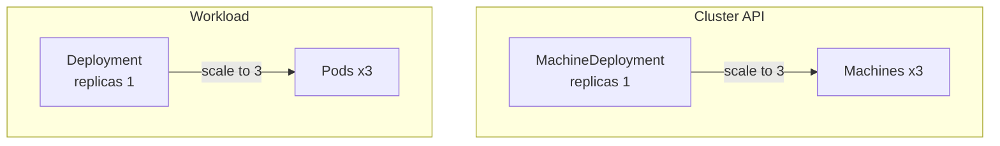
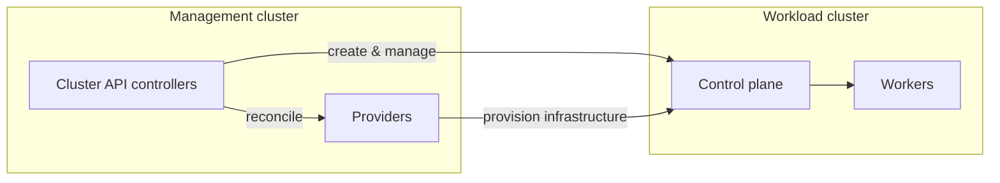
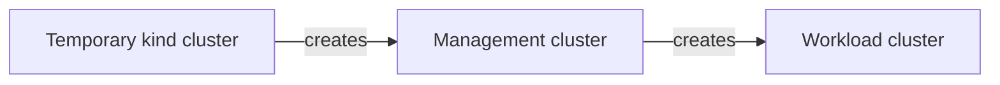
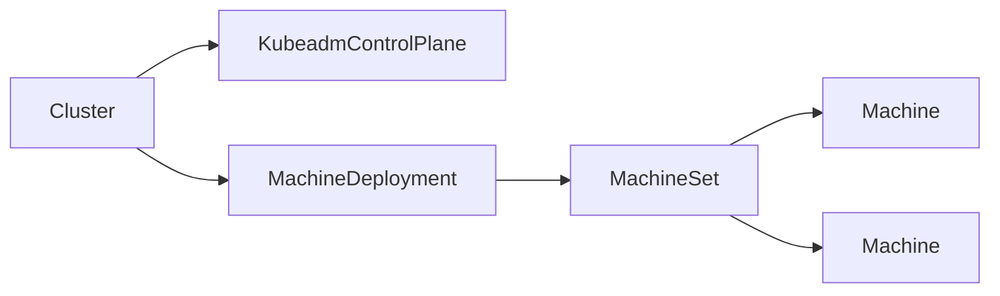
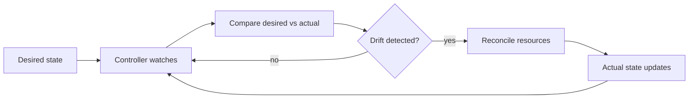
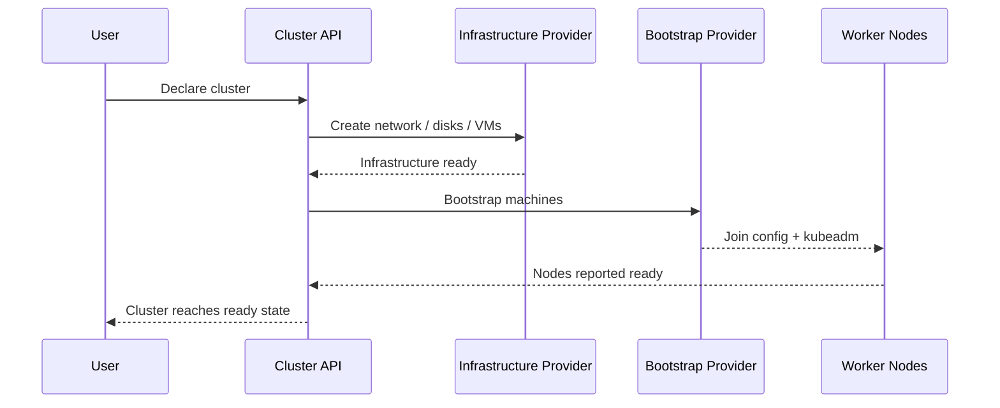
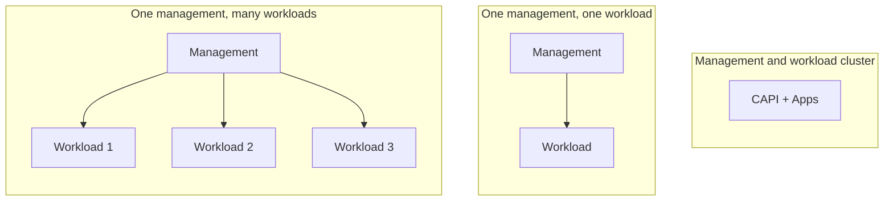

<!-- .slide: data-visibility="hidden" -->

## Why this matters

<i class="fa-duotone fa-solid fa-4x fa-rocket"></i> <!-- .element: style="float: right;" -->

- Many teams still create clusters by hand
- Honorable mention for those with managed clusters with automation
- Manual setup causes drift, inconsistency, slow recovery
- Kubernetes already has the right control-loop model

---

## What is Cluster API (CAPI)?

<i class="fa-duotone fa-solid fa-4x fa-server"></i> <!-- .element: style="float: right;" -->

- Kubernetes native cluster lifecycle
- Everything represented as resources
- Managed by controllers (think reconciliation loop)
- Runs in a management cluster, reconciles declaratively
- Official project by Kubernetes SIG Cluster Lifecycle

### The ease of `Deployment` but for nodes <i class="fa fa-sparkles"></i>



---

```yaml
apiVersion: cluster.x-k8s.io/v1beta2
kind: Cluster
metadata:
  name: foo
spec:
  clusterNetwork:
    services:
      cidrBlocks:
      - 100.64.0.0/16  # CGNAT
  controlPlaneEndpoint:
    host: https://redacted.eu-central-1.eks.amazonaws.com
    port: 443
  controlPlaneRef:
    apiGroup: controlplane.cluster.x-k8s.io
    kind: AWSManagedControlPlane
    name: foo
  infrastructureRef:
    apiGroup: infrastructure.cluster.x-k8s.io
    kind: AWSManagedCluster
    name: foo
```

<!-- .element: style="width: 34em; height: 28em; float: right;" -->

```yaml
apiVersion: cluster.x-k8s.io/v1beta2
kind: Cluster
metadata:
  name: bar
spec:
  clusterNetwork:
    pods:
      cidrBlocks:
      - 100.64.128.0/17
    services:
      cidrBlocks:
      - 100.64.0.0/17
  controlPlaneEndpoint:
    host: 10.0.0.10
    port: 6443
  controlPlaneRef:
    apiGroup: controlplane.cluster.x-k8s.io
    kind: KubeadmControlPlane
    name: bar
  infrastructureRef:
    apiGroup: infrastructure.cluster.x-k8s.io
    kind: VSphereCluster
    name: bar
```

<!-- .element: style="width: 34em; height: 28em;" -->

---

```yaml
apiVersion: infrastructure.cluster.x-k8s.io/v1beta2
kind: AWSManagedMachinePool
metadata:
  name: worker
spec:
  amiType: AL2023_x86_64_STANDARD
  amiVersion: 1.37.1-20261023
  capacityType: onDemand
  eksNodegroupName: worker
  instanceType: m8i-flex.4xlarge
  providerIDList:
  - [REDACTED]
  roleName: foo-worker-iam-service-role
  scaling:
    maxSize: 8
    minSize: 1
  updateConfig:
    maxUnavailable: 1
```

<!-- .element: style="width: 34em; height: 34em; float: right;" -->

```yaml
apiVersion: cluster.x-k8s.io/v1beta2
kind: MachineDeployment
metadata:
  name: worker
spec:
  clusterName: foo
  replicas: 3
  selector:
    matchLabels:
      cluster.x-k8s.io/cluster-name: foo
      cluster.x-k8s.io/deployment-name: worker
  template:
    metadata:
      labels:
        cluster.x-k8s.io/cluster-name: foo
        cluster.x-k8s.io/deployment-name: worker
    spec:
      bootstrap:
        configRef:
          apiGroup: bootstrap.cluster.x-k8s.io
          kind: KubeadmConfigTemplate
          name: worker
      clusterName: foo
      infrastructureRef:
        apiGroup: infrastructure.cluster.x-k8s.io
        kind: VSphereMachineTemplate
        name: worker
      version: v1.37.1
```

<!-- .element: style="width: 34em; height: 34em;" -->

---

## Management and workload clusters

<i class="fa-duotone fa-solid fa-4x fa-diagram-project"></i> <!-- .element: style="float: right;" -->

- Management cluster is the control plane for CAPI
- It hosts controllers and infrastructure providers
- Workload cluster is created and managed by it



---

## Demo

<i class="fa-duotone fa-solid fa-4x fa-terminal"></i> <!-- .element: style="float: right;" -->

- Create a temporary management cluster
- Initialize Cluster API with provider
- Generate and apply the cluster manifest
- Fetch the kubeconfig and watch nodes
- Move management role to the new cluster
- Create the first workload cluster from it



---

## Demo 1: Create the management cluster

<i class="fa-duotone fa-solid fa-4x fa-terminal"></i> <!-- .element: style="float: right;" -->

Create a temporary management cluster using `kind`

```shell
kind create cluster --name temporary
```

Any alternative works as well: `k3s`, `k3d` etc.

---

## Demo 2: Initialize Cluster API

<i class="fa-duotone fa-solid fa-4x fa-terminal"></i> <!-- .element: style="float: right;" -->

Initialize Cluster API with the provider

```bash
export SCW_ACCESS_KEY="$( scw config get access-key )"
export SCW_SECRET_KEY="$( scw config get secret-key )"
export SCW_PROJECT_ID="$( scw config get default-project-id )"
export SCW_REGION="$( scw config get default-region )"

clusterctl init \
  --infrastructure scaleway

kubectl get pods -A
```

XXX https://github.com/scaleway/cluster-api-provider-scaleway

---

## Demo 3: Generate the cluster definition

<i class="fa-duotone fa-solid fa-4x fa-terminal"></i> <!-- .element: style="float: right;" -->

Generate a workload cluster definition

```bash
export MGMT_CLUSTER_NAME="management"
export KUBERNETES_VERSION=v1.36.1
export MGMT_CONTROL_PLANE_MACHINE_COUNT=3
export MGMT_WORKER_MACHINE_COUNT=3
export CONTROL_PLANE_MACHINE_IMAGE=cluster-api-ubuntu-2604-v1.36.1
export WORKER_MACHINE_IMAGE=cluster-api-ubuntu-2604-v1.36.1

clusterctl generate cluster ${MGMT_CLUSTER_NAME} \
  --infrastructure scaleway \
  --kubernetes-version ${KUBERNETES_VERSION} \
  --control-plane-machine-count ${MGMT_CONTROL_PLANE_MACHINE_COUNT} \
  --worker-machine-count ${MGMT_WORKER_MACHINE_COUNT} \
  > ${MGMT_CLUSTER_NAME}.yaml
```

XXX fix API server port

XXX show CIDR ranges and machine type

---

## Demo 4: Apply and watch

<i class="fa-duotone fa-solid fa-4x fa-terminal"></i> <!-- .element: style="float: right;" -->

Apply it and watch the cluster come up

```bash
kubectl apply -f ${MGMT_CLUSTER_NAME}.yaml
watch clusterctl describe cluster ${MGMT_CLUSTER_NAME}
scw instance server list
kubectl get clusters,machines,machinesets
```

XXX Check cluster with https://github.com/Jont828/cluster-api-visualizer?

---

## Demo 4: XXX

<i class="fa-duotone fa-solid fa-4x fa-terminal"></i> <!-- .element: style="float: right;" -->

Get `kubeconfig` for the management cluster:

```shell
clusterctl get kubeconfig management >${MGMT_CLUSTER_NAME}.kubeconfig
```

Deploy CNI:

```shell
helm repo add cilium https://helm.cilium.io/
helm repo update
helm install cilium cilium/cilium --namespace kube-system
cilium --kubeconfig kubeconfig status
```

Deploy CCM:

```shell
cat <<EOF >scaleway-secret.yaml
apiVersion: v1
kind: Secret
metadata:
  name: scaleway-secret
  namespace: kube-system
type: Opaque
stringData:
  SCW_ACCESS_KEY: "$( scw config get access-key )"
  SCW_SECRET_KEY: "$( scw config get secret-key )"
  SCW_DEFAULT_PROJECT_ID: "$( scw config get default-project-id )"
  SCW_DEFAULT_REGION: "$( scw config get default-region )"
  SCW_DEFAULT_ZONE: "$( scw config get default-zone )"
EOF
kubectl --kubeconfig kubeconfig apply -f https://github.com/scaleway/scaleway-cloud-controller-manager/raw/refs/tags/v0.36.2/examples/k8s-scaleway-ccm-latest.yml
```

---

## Core resources

<i class="fa-duotone fa-solid fa-4x fa-cubes"></i> <!-- .element: style="float: right;" -->

`Cluster` cluster definition and topology

`KubeadmControlPlane` control plane resources

`MachineDeployment` rolls out machine sets over time

`MachineSet` machines at a fixed replica count

`Machine` one node to create or replace



---

```yaml
XXX KubeadmControlPlane
XXX KubeadmConfigTemplate
```

---

## Infrastructure providers

<i class="fa-duotone fa-solid fa-4x fa-cloud"></i> <!-- .element: style="float: right;" -->

- The API stays generic
- Providers add platform specifics
- Providers create VMs, networks, disks, load balancers
- Additional provider-specific resources
- Pluggable API with platform-specific machinery

Official list of [infrastructure providers](https://cluster-api.sigs.k8s.io/reference/providers.html#infrastructure).

*Sidenote: Docker provider for local testing and development*

---

```yaml
XXX example resources for Scaleway provider
```

---

## Bootstrap providers

<i class="fa-duotone fa-solid fa-4x fa-wand-sparkles"></i> <!-- .element: style="float: right;" -->

- Prepare machines to join the target cluster
- Handle OS config, kubeadm, and join details
- Separation from infrafrastructure
- Again: pluggable API
- Defaults to `kubeadm`

Official list of [bootstrap providers](https://cluster-api.sigs.k8s.io/reference/providers.html#bootstrap).

---

<!-- .slide: data-visibility="hidden" -->

## The reconciliation loop

<i class="fa-duotone fa-solid fa-4x fa-repeat"></i> <!-- .element: style="float: right;" -->

- Controllers watch CAPI objects and provider state
- Compare desired vs actual to spot drift
- Create, patch, or replace until converged



---

## Cluster creation flow

<i class="fa-duotone fa-solid fa-4x fa-arrows-spin"></i> <!-- .element: style="float: right;" -->

- Declare the infrastructure
- Declare the control plane
- Declare workers
- Providers create and bootstrap the nodes
- Everything converges to a ready state



---

## Demo 5: Remove cluster

<i class="fa-duotone fa-solid fa-4x fa-terminal"></i> <!-- .element: style="float: right;" -->

Hand management over to the new cluster

```bash
kubectl delete cluster management
w scw instance server list
kind delete cluster --name temporary
```

XXX next steps: deploy CSI https://github.com/scaleway/scaleway-csi

XXX next steps: Build your own image using `image-builder` https://github.com/kubernetes-sigs/image-builder, https://image-builder.sigs.k8s.io/capi/providers/scaleway

---

## Upgrades and rolling changes

<i class="fa-duotone fa-solid fa-4x fa-arrow-trend-up"></i> <!-- .element: style="float: right;" -->

- Controlled replacement and rollout workflows
- MachineDeployment for worker-node lifecycle
- Provider-aware control-plane upgrades
- Repeatable, observable, safer cluster evolution

XXX Machine drain rules

---

## GitOps-friendly

<i class="fa-duotone fa-solid fa-4x fa-code-branch"></i> <!-- .element: style="float: right;" -->

- Definitions are declarative manifests
- Changes are reviewable, repeatable, auditable
- Drift is visible and reconciled automatically
- Easy to wrap in helm or kustomize

---

## Multi-cluster management

<i class="fa-duotone fa-solid fa-4x fa-people-group"></i> <!-- .element: style="float: right;" -->

- Many environments, one declarative model
- Every cluster is reproducible from it
- Less scripting, consistent lifecycle pattern



---

## More abstraction

<i class="fa-duotone fa-solid fa-4x fa-layer-group"></i> <!-- .element: style="float: right;" -->

IP Address Management (IPAM) using `InClusterIPPool` [](https://github.com/kubernetes-sigs/cluster-api-ipam-provider-in-cluster)

Deploy helm charts using `HelmChartProxy` [](https://github.com/kubernetes-sigs/cluster-api-addon-provider-helm/)

Create many similar clusters using `ClusterClass` [](https://cluster-api.sigs.k8s.io/tasks/experimental-features/cluster-class/index.html)
