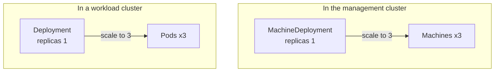
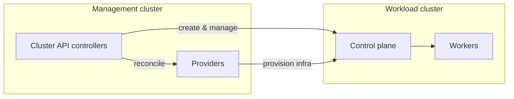
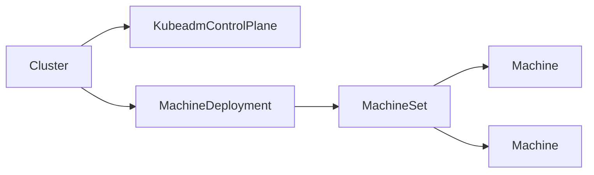
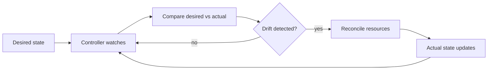
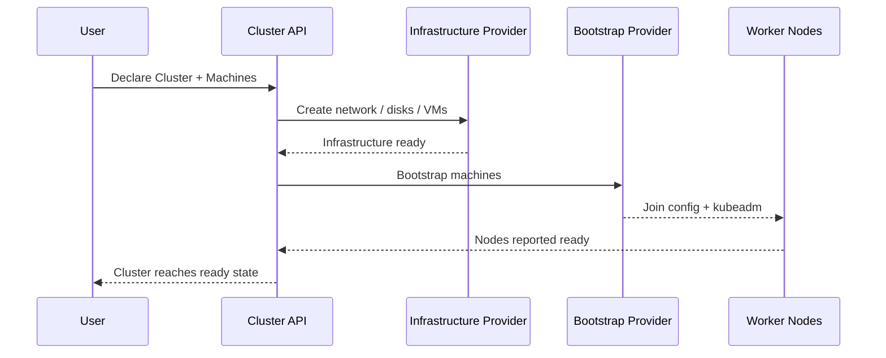
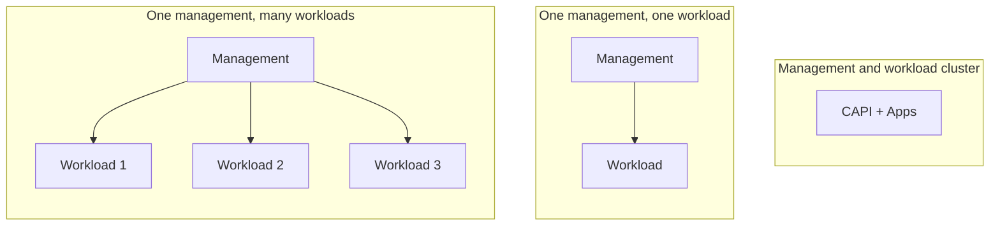
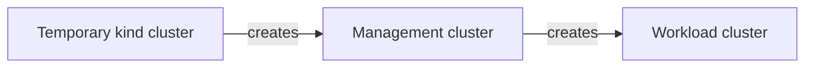

## Why this matters

<i class="fa-duotone fa-solid fa-4x fa-rocket"></i> <!-- .element: style="float: right;" -->

- Many teams still create clusters by hand
- Honorable mention for those with managed clusters with automation
- Manual setup causes drift, inconsistency, slow recovery
- Kubernetes already has the right control-loop model

---

## What is Cluster API?

<i class="fa-duotone fa-solid fa-4x fa-server"></i> <!-- .element: style="float: right;" -->

- Kubernetes native cluster lifecycle
- Everything represented as resources and managed by controllers
- Runs in a management cluster, reconciles declaratively
- Portable abstraction

### The ease of `Deployment` but for nodes <i class="fa fa-sparkles"></i>



---

## The problem it solves

<i class="fa-duotone fa-solid fa-4x fa-bug-slash"></i> <!-- .element: style="float: right;" -->

- Scripts work for one cluster, not for many
- Per-environment provisioning logic causes drift
- One declarative API instead of custom commands

---

## The key mental model

<i class="fa-duotone fa-solid fa-4x fa-brain"></i> <!-- .element: style="float: right;" -->

- Desired state lives in Kubernetes objects
- Controllers compare and reconcile continuously
- Same model as workloads and it scales to infrastructure

---

```yaml
apiVersion: cluster.x-k8s.io/v1beta2
kind: Cluster
metadata:
  name: foo
spec:
  clusterNetwork:
    services:
      cidrBlocks:
      - 100.64.0.0/16  # CGNAT
  controlPlaneEndpoint:
    host: https://redacted.eu-central-1.eks.amazonaws.com
    port: 443
  controlPlaneRef:
    apiGroup: controlplane.cluster.x-k8s.io
    kind: AWSManagedControlPlane
    name: foo
  infrastructureRef:
    apiGroup: infrastructure.cluster.x-k8s.io
    kind: AWSManagedCluster
    name: foo
```

<!-- .element: style="width: 34em; height: 28em; float: right;" -->

```yaml
apiVersion: cluster.x-k8s.io/v1beta2
kind: Cluster
metadata:
  name: bar
spec:
  clusterNetwork:
    pods:
      cidrBlocks:
      - 100.64.128.0/17
    services:
      cidrBlocks:
      - 100.64.0.0/17
  controlPlaneEndpoint:
    host: 10.0.0.10
    port: 6443
  controlPlaneRef:
    apiGroup: controlplane.cluster.x-k8s.io
    kind: KubeadmControlPlane
    name: bar
  infrastructureRef:
    apiGroup: infrastructure.cluster.x-k8s.io
    kind: VSphereCluster
    name: bar
```

<!-- .element: style="width: 34em; height: 28em;" -->

---

```yaml
apiVersion: infrastructure.cluster.x-k8s.io/v1beta2
kind: AWSManagedMachinePool
metadata:
  name: worker
spec:
  amiType: AL2023_x86_64_STANDARD
  amiVersion: 1.37.1-20261023
  capacityType: onDemand
  eksNodegroupName: worker
  instanceType: m8i-flex.4xlarge
  providerIDList:
  - [REDACTED]
  roleName: foo-worker-iam-service-role
  scaling:
    maxSize: 8
    minSize: 1
  updateConfig:
    maxUnavailable: 1
```

<!-- .element: style="width: 34em; height: 28em; float: right;" -->

```yaml
apiVersion: cluster.x-k8s.io/v1beta2
kind: MachineDeployment
metadata:
  name: worker
spec:
  clusterName: foo
  replicas: 3
  selector:
    matchLabels:
      cluster.x-k8s.io/cluster-name: foo
      cluster.x-k8s.io/deployment-name: worker
  template:
    metadata:
      labels:
        cluster.x-k8s.io/cluster-name: foo
        cluster.x-k8s.io/deployment-name: worker
        haufedev.systems/node-type: services
    spec:
      bootstrap:
        configRef:
          apiGroup: bootstrap.cluster.x-k8s.io
          kind: KubeadmConfigTemplate
          name: worker
      clusterName: foo
      infrastructureRef:
        apiGroup: infrastructure.cluster.x-k8s.io
        kind: VSphereMachineTemplate
        name: worker
      version: v1.37.1
```

<!-- .element: style="width: 34em; height: 35em;" -->

---

## Management cluster vs workload cluster

<i class="fa-duotone fa-solid fa-4x fa-diagram-project"></i> <!-- .element: style="float: right;" -->

- Management cluster is the control plane
- It hosts controllers and infrastructure providers
- Workload cluster is created and managed by it



---

## Core resources

<i class="fa-duotone fa-solid fa-4x fa-cubes"></i> <!-- .element: style="float: right;" -->

- Cluster: cluster definition and topology
- KubeadmControlPlane: control plane resources
- MachineDeployment: rolls out machine sets over time
- MachineSet: machines at a fixed replica count
- Machine: one node to create or replace



---

## Infrastructure providers

<i class="fa-duotone fa-solid fa-4x fa-cloud"></i> <!-- .element: style="float: right;" -->

- The API stays generic
- Providers add platform specifics
- Providers create VMs, networks, disks, load balancers
- Portable API with platform-specific machinery

---

## Bootstrap providers

<i class="fa-duotone fa-solid fa-4x fa-wand-sparkles"></i> <!-- .element: style="float: right;" -->

- Prepare machines to join the target cluster
- Handle OS config, kubeadm, and join details
- Separation from infrafrastructure
- Modular and portable

---

## The reconciliation loop

<i class="fa-duotone fa-solid fa-4x fa-repeat"></i> <!-- .element: style="float: right;" -->

- Controllers watch CAPI objects and provider state
- Compare desired vs actual to spot drift
- Create, patch, or replace until converged



---

## Cluster creation flow

<i class="fa-duotone fa-solid fa-4x fa-arrows-spin"></i> <!-- .element: style="float: right;" -->

- Define infrastructure: networks, disks, compute
- Define the Cluster and control plane topology
- Create MachineDeployments for workers
- Providers create and bootstrap the nodes
- Everything converges to a ready state



---

## Upgrades and rolling changes

<i class="fa-duotone fa-solid fa-4x fa-arrow-trend-up"></i> <!-- .element: style="float: right;" -->

- Controlled replacement and rollout workflows
- MachineDeployment for worker-node lifecycle
- Provider-aware control-plane upgrades
- Repeatable, observable, safer cluster evolution

XXX Machine drain rules

---

## GitOps-friendly

<i class="fa-duotone fa-solid fa-4x fa-code-branch"></i> <!-- .element: style="float: right;" -->

- Definitions are declarative manifests
- Changes are reviewable, repeatable, auditable
- Drift is visible and reconciled automatically
- Easy to wrap in helm or kustomize

---

## Multi-cluster management

<i class="fa-duotone fa-solid fa-4x fa-people-group"></i> <!-- .element: style="float: right;" -->

- Many environments, one declarative model
- Every cluster is reproducible from it
- Less scripting, consistent lifecycle pattern



---

## Operational realities

<i class="fa-duotone fa-solid fa-4x fa-triangle-exclamation"></i> <!-- .element: style="float: right;" -->

- You still need a management cluster
- Provider maturity varies across clouds
- RBAC and security boundaries still matter
- Debugging means conditions, events, controller logs

### Common pitfalls

- Treating CAPI as a cloud abstraction only
- Expecting identical behavior across backends
- Skipping observability and debugging setup
- Forgetting CAPI complements existing tooling

---

## Demo

<i class="fa-duotone fa-solid fa-4x fa-terminal"></i> <!-- .element: style="float: right;" -->

- Create a temporary management cluster
- Initialize Cluster API with provider for Hetzner
- Generate and apply the cluster manifest
- Fetch the kubeconfig and watch nodes
- Move management role to the new cluster
- Create the first workload cluster from it



---

## Demo 1: Create the management cluster

<i class="fa-duotone fa-solid fa-4x fa-terminal"></i> <!-- .element: style="float: right;" -->

Create a temporary management cluster using `kind`

```bash
kind create cluster --name temporary
```

---

## Demo 2: Initialize Cluster API

<i class="fa-duotone fa-solid fa-4x fa-terminal"></i> <!-- .element: style="float: right;" -->

Initialize Cluster API with the Hetzner provider

```bash
export HCLOUD_TOKEN="<your-hcloud-token>"
export HCLOUD_SSH_KEY="<ssh-key-name>"

clusterctl init \
  --infrastructure hcloud \
  --bootstrap kubeadm \
  --control-plane kubeadm
```

---

## Demo 3: Generate the cluster definition

<i class="fa-duotone fa-solid fa-4x fa-terminal"></i> <!-- .element: style="float: right;" -->

Generate a workload cluster definition

```bash
export MGMT_CLUSTER_NAME="management"
export KUBERNETES_VERSION=v1.37.0
export MGMT_CONTROL_PLANE_MACHINE_COUNT=3
export MGMT_WORKER_MACHINE_COUNT=3

clusterctl generate cluster ${MGMT_CLUSTER_NAME} \
  --infrastructure hcloud \
  --kubernetes-version ${KUBERNETES_VERSION} \
  --control-plane-machine-count ${MGMT_CONTROL_PLANE_MACHINE_COUNT} \
  --worker-machine-count ${MGMT_WORKER_MACHINE_COUNT} \
  > ${MGMT_CLUSTER_NAME}.yaml
```

---

## Demo 4: Apply and watch

<i class="fa-duotone fa-solid fa-4x fa-terminal"></i> <!-- .element: style="float: right;" -->

Apply it and watch the cluster come up

```bash
kubectl apply -f ${MGMT_CLUSTER_NAME}.yaml
kubectl get clusters,machines,machinesets -A -w
```

---

## Demo 5: Fetch the kubeconfig

<i class="fa-duotone fa-solid fa-4x fa-terminal"></i> <!-- .element: style="float: right;" -->

Fetch the kubeconfig once the cluster is ready

```bash
clusterctl get kubeconfig ${MGMT_CLUSTER_NAME} > ${MGMT_CLUSTER_NAME}.kubeconfig
kubectl --kubeconfig=${MGMT_CLUSTER_NAME}.kubeconfig get nodes
```

---

## Demo 6: Move the management role

<i class="fa-duotone fa-solid fa-4x fa-terminal"></i> <!-- .element: style="float: right;" -->

Hand management over to the new cluster

```bash
clusterctl init \
  --infrastructure hcloud \
  --bootstrap kubeadm \
  --control-plane kubeadm \
  --kubeconfig ${MGMT_CLUSTER_NAME}.kubeconfig

clusterctl move \
  --to-kubeconfig ${MGMT_CLUSTER_NAME}.kubeconfig

kubectl --kubeconfig ${MGMT_CLUSTER_NAME}.kubeconfig \
  get clusters,machines -A
```

---

## Demo 7: Create a workload cluster

<i class="fa-duotone fa-solid fa-4x fa-terminal"></i> <!-- .element: style="float: right;" -->

Same commands, now from the self-hosted management cluster

```bash
export WORK_CLUSTER_NAME="workload"
export KUBECONFIG=${MGMT_CLUSTER_NAME}.kubeconfig
export WORK_CONTROL_PLANE_MACHINE_COUNT=3
export WORK_WORKER_MACHINE_COUNT=5

clusterctl generate cluster ${WORK_CLUSTER_NAME} \
  --infrastructure hcloud \
  --kubernetes-version ${KUBERNETES_VERSION} \
  --control-plane-machine-count ${WORK_CONTROL_PLANE_MACHINE_COUNT} \
  --worker-machine-count ${WORK_WORKER_MACHINE_COUNT} \
  > ${WORK_CLUSTER_NAME}.yaml

kubectl apply -f ${WORK_CLUSTER_NAME}.yaml
kubectl get clusters,machines -A -w
```

<!-- .element: style="height: 18em;" -->
